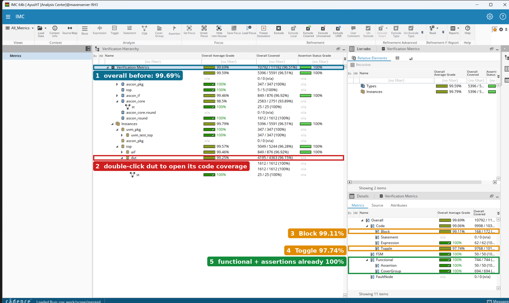
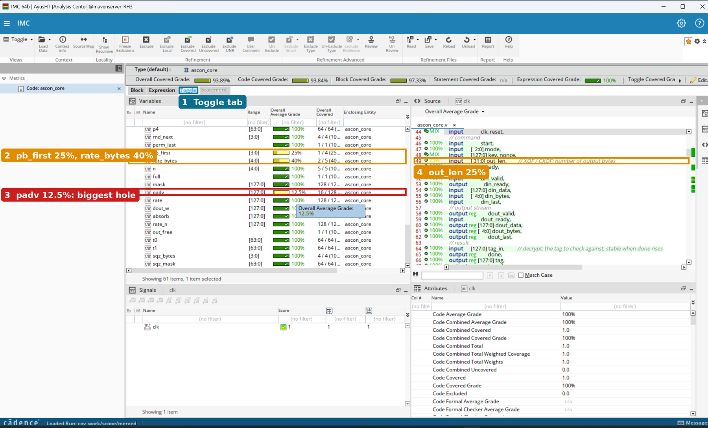
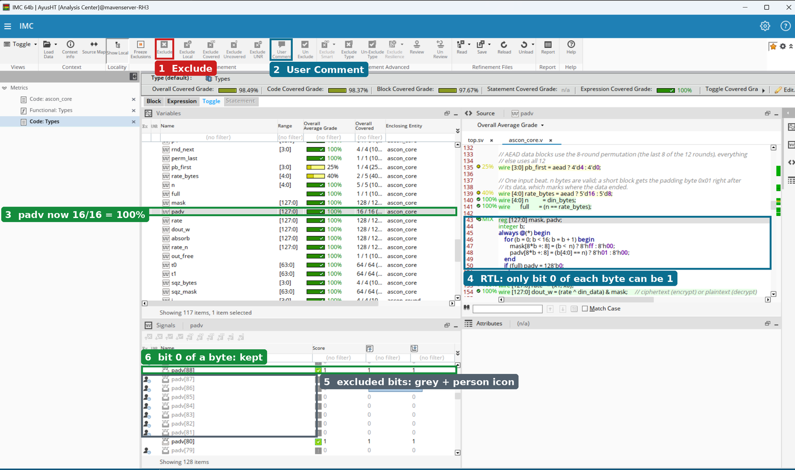
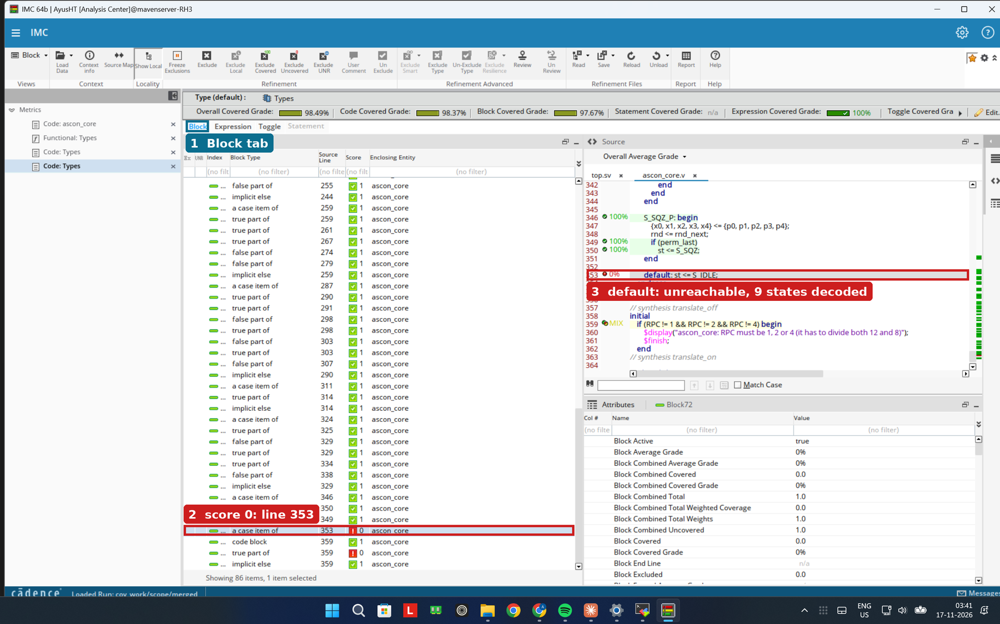
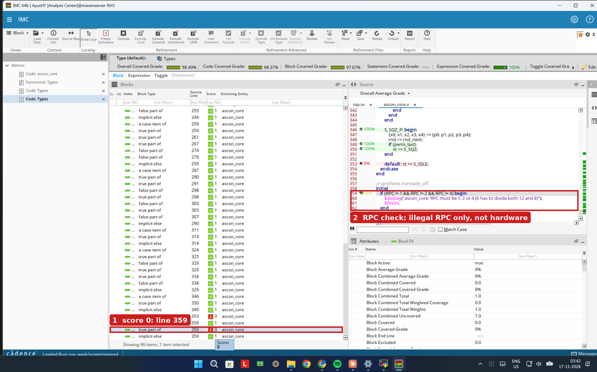
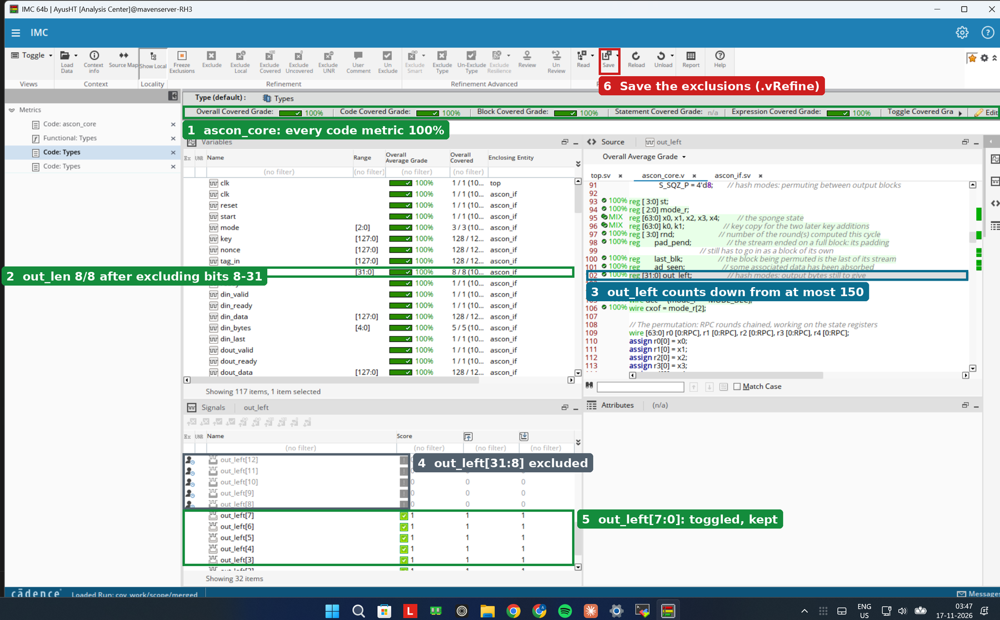
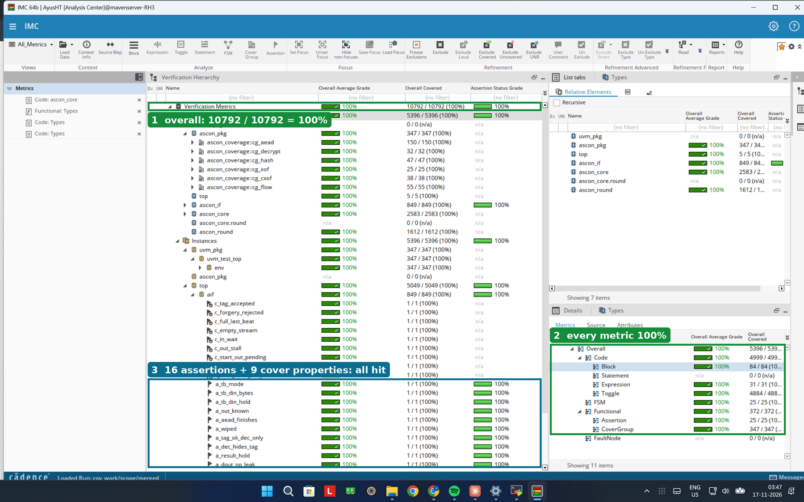

# Coverage closure: from 99.69% to 100%, step by step

How the last coverage holes of `ascon_core` were found, explained and excluded in Cadence
IMC. Every screenshot is from the real merged run of the 9-test regression
(`verif/uvm/sim`, `make regress`, Xcelium 24.09, IMC 25.03). The numbered tags on each
image match the numbered notes under it.

**The rule followed throughout:** a hole is excluded only when reading the RTL shows it
can never be reached in a correct design, and every exclusion carries a written reason.
A hole that a test could reach would be fixed with a test instead.

| | Before | After |
|---|---|---|
| Overall | 99.69% | **100%** (10792 / 10792) |
| Block | 99.11% | **100%** |
| Toggle | 97.74% | **100%** |
| Expression, FSM, Assertion, CoverGroup | 100% | **100%** |

## Step 1: open the merged coverage and find what is not 100%

```sh
cd verif/uvm/sim
make cov_merge
imc -load cov_work/scope/merged &
```



1. The overall grade before closure: 99.69%.
2. The DUT instance. Double-click it to open its code coverage.
3. Block coverage 99.11%: some lines of RTL never ran.
4. Toggle coverage 97.74%: some bits never went 0 to 1 and back.
5. Functional coverage (covergroups) and assertions were already 100%. Only code coverage
   needed work.

## Step 2: find the toggle holes



1. Open the **Toggle** tab. Sorting by the grade column brings the holes to the top.
2. `pb_first` (25%) and `rate_bytes` (40%).
3. `padv` (12.5%), the largest hole.
4. `out_len` (25%), on the port list in the source pane.

All of them are signals whose values are restricted by the design:

| Signal | Possible values | Why bits stay constant |
|---|---|---|
| `padv` [127:0] | `0x01` in one byte, zeros elsewhere | The padding byte is always `0x01`: bits 1 to 7 of every byte can never be 1 (112 of 128 bits). 1/8 = 12.5% |
| `pb_first` [3:0] | 0 or 4 | First round number: 0 for 12 rounds, 4 for 8 rounds. Only bit 2 changes |
| `rate_bytes` [4:0] | 8 or 16 | Block size: hash modes 8, AEAD 16. Only bits 3 and 4 change |
| `out_len` [31:0], `out_left` [31:0] | 0 to 150 in the tests | Bits 8 to 31 would mean asking for 256 bytes to 4 GB of hash output |

## Step 3: exclude the constant bits of padv, with a reason



Select the signal (or the individual bits in the Signals pane), then:

1. **Exclude** in the Refinement toolbar.
2. **User Comment**: type the reason. For `padv`:
   `padding byte is always 0x01: bits 1-7 of every byte are constant 0 by design`.
3. `padv` is now 16 / 16 = 100%: only the 16 bits that can change are counted.
4. The RTL that justifies it: `padv[8*b +: 8] = (b[4:0] == n) ? 8'h01 : 8'h00`.
5. Excluded bits turn grey and get the person icon (a user exclusion).
6. Bit 0 of each byte (`padv[88]`, `padv[80]`, ...) stays counted, and was toggled.

`pb_first` and `rate_bytes` are excluded the same way, with the reasons in the table
above.

## Step 4: block hole 1, the `default` of the state machine



1. Open the **Block** tab.
2. The only rows with score 0. The first is line 353.
3. `default: st <= S_IDLE;`. The state register `st` is only ever assigned one of the 9
   named states, so no other value can reach the case statement. The line is a safety net
   for a corrupted state register (radiation, a glitch), which RTL simulation cannot
   produce, so it stays in the design and is excluded from coverage.
   Reason: `defensive default, all 9 states decoded; unreachable in RTL simulation`.

## Step 5: block hole 2, the parameter check



1. The second score-0 row: line 359.
2. The check that stops simulation if `RPC` (rounds per cycle) is not 1, 2 or 4. It can
   only fire for an illegal parameter, every test builds a legal core, and it sits inside
   `synthesis translate_off`, so it is not hardware at all.
   Reason: `elaboration-time parameter check, not hardware; legal RPC in every run`.

## Step 6: exclude the unused length bits and save the exclusions



1. `ascon_core` now shows 100% for every code metric.
2. `out_len` is 8 / 8 after excluding bits 8 to 31.
3. `out_left`, the counter of hash output still to give, starts from `out_len` and counts
   down, so it never goes above 150 either.
4. `out_left[31:8]` excluded (grey).
5. `out_left[7:0]` toggled and still counted.
   Reason for both: `tests request up to 150 output bytes; bits 8-31 would mean
   256 B to 4 GB of output, not exercised`.
6. **Save** (Refinement Files) writes every exclusion with its comment to a `.vRefine`
   file in `verif/uvm/sim`. The file is what makes the exclusions repeatable: it is loaded
   again on every new merge instead of redoing the clicks.

## Step 7: the result



1. Overall 10792 / 10792 = 100%.
2. Every metric: Block, Expression, Toggle, FSM, Assertion and CoverGroup at 100%.
3. All 16 assertions passed and all 9 cover properties were hit.

## Why this matters

- Coverage at 100% *before* exclusions is not the goal, and is not normal: real designs
  always have constant bits and defensive code. What reviewers look for is that every
  exclusion is justified from the RTL and written down.
- Two holes here are worth explaining in an interview:
  - `padv` at 12.5% was a sign the design is right (only bit 0 of the padding byte can
    ever be set), not a missing test.
  - The `default:` of the state machine is kept in the RTL on purpose and excluded from
    coverage on purpose. Both decisions are correct at the same time.
